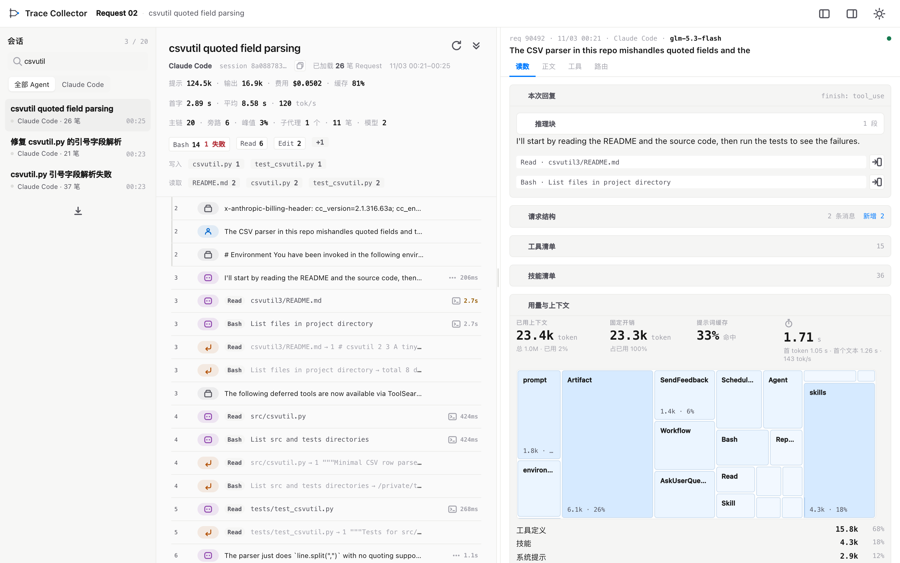
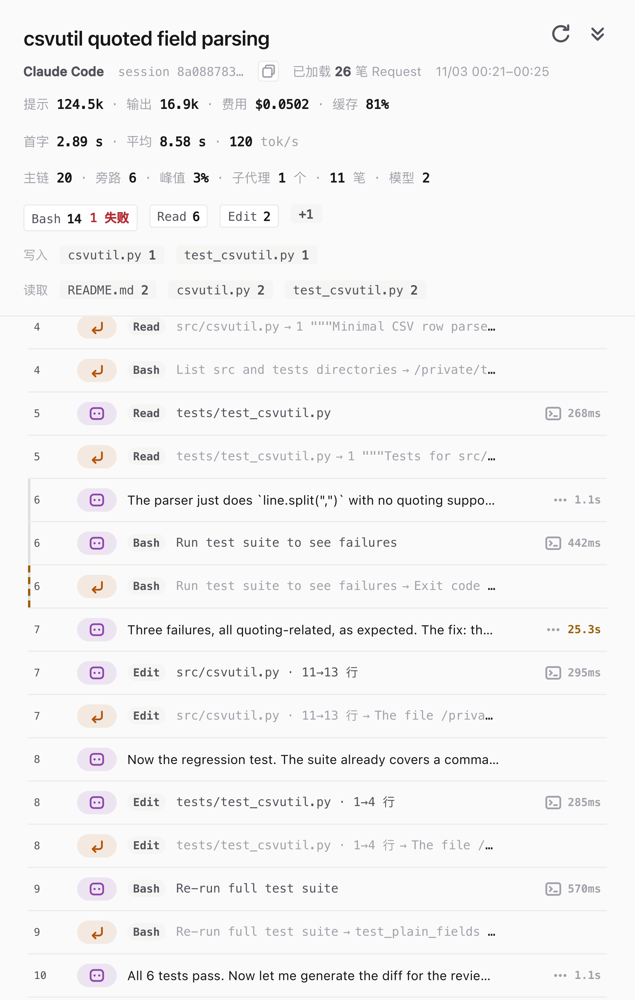
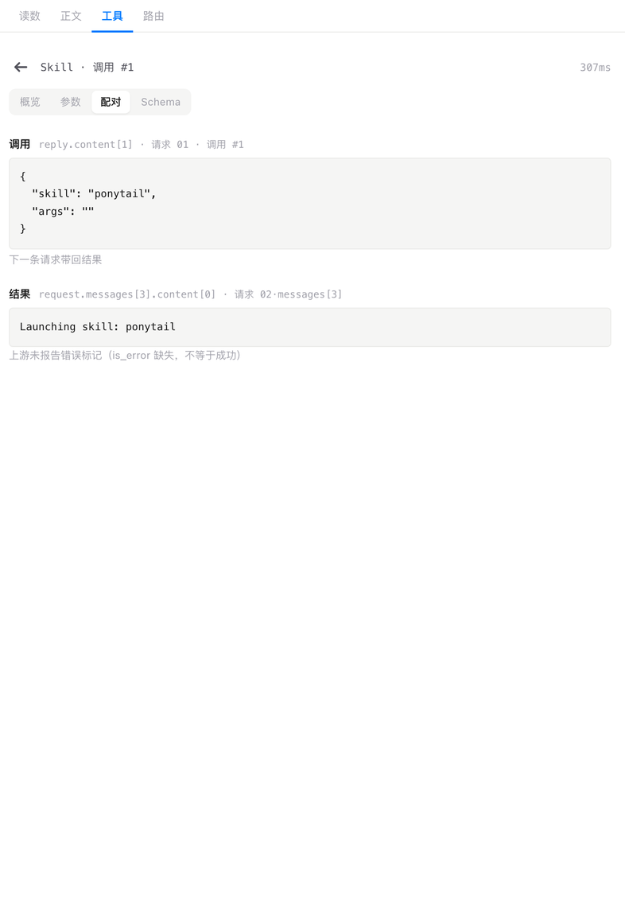
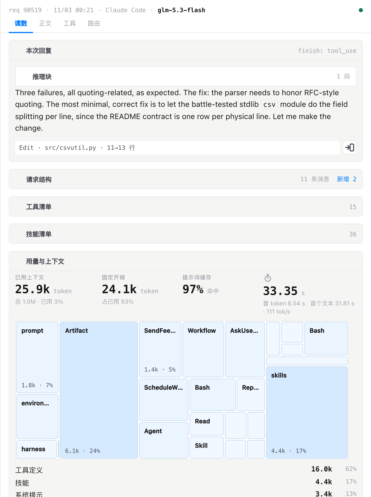

# Tracery

[](https://github.com/PisK4/tracery/actions/workflows/ci.yml)
[](LICENSE)
[](https://bun.sh)
[](package.json)
[](tests)
[](README.zh-CN.md)

**English** ｜ [简体中文](README.zh-CN.md)

**Tracery records the requests your coding agent sends, and lets you read them step by step.**

A coding agent fires dozens of LLM calls per session. Your observability platform tells you the cost and the latency of each call. It does not tell you which messages were actually in the request body, how the system prompt was assembled, or what changed between request N and request N-1.

Tracery keeps the raw request. It records each call as a request — the assembled protocol object, the reply, routing decisions, and usage — then reads those requests back as one session you can walk through line by line.



It sits next to the data path, not in it. It is not a proxy: it forwards nothing, rewrites nothing, intercepts nothing. When it isn't running, your agent's requests go through exactly as before — there is just no record of them.

## Why

- **See what was sent.** Which messages went to the model on a given turn, what the system prompt was assembled from, how tool results were fed back.
- **Locate the problem.** Which request failed, truncated, or retried — and which messages differ from the request before it.
- **Compare across harnesses.** Requests from different agents land in the same readings, the same trace structure, the same session list.

## How it works

Three independent ingestion paths write into one SQLite database. You can enable any of them, or all three.

### Path 1 — magpie gateway: three-way evidence, full request bodies

[magpie](https://github.com/yetone/magpie) is an LLM gateway that records evidence at the point of send: a hook captures the client protocol request body and the merged reply, a usage ledger carries status, usage, `route_id` and `response_id`, and routing history carries candidate order, attempts and rules. Tracery reconciles all three into a single request row keyed on `response_id` and `route_id`.

Bodies come from the hook. Register [`plugins/collector.hooks.ts`](plugins/collector.hooks.ts) in magpie's plugin config and give it the `hook.token` that Tracery generates on first start. The plugin does three things: it tags the request with a `hook_id`, reports the complete object when the call finishes, and records delivery outcomes under fixed codes. It never rewrites bodies, never correlates, never redacts.

Without the hook you still get the ledger and routing evidence — just no request or reply bodies.

### Path 2 — OTLP: the harness exports its own spans

No magpie required. Claude Code, OMP and Codex CLI are supported today: point their OTLP exporter at `POST /v1/traces` and `POST /v1/logs` on the local endpoint, authenticated with the generated `otlp.token`.

The token file holds 32 raw bytes. Export the base64url form as an environment variable — `cat`-ing the file puts non-ASCII bytes into `Authorization` and the request is rejected as malformed at the HTTP layer:

```sh
ATC_TOKEN=$(base64 -i '<dataDir>/otlp.token' | tr '+/' '-_' | tr -d '\n=')
export OTEL_EXPORTER_OTLP_ENDPOINT=http://127.0.0.1:8320
export OTEL_EXPORTER_OTLP_HEADERS="authorization=Bearer $ATC_TOKEN"
```

- **Claude Code** — LLM spans become request rows. For per-request bodies also set `OTEL_LOG_RAW_API_BODIES=file`; the harness writes full request and reply bodies to files and puts pointers in the event, and Tracery reads them in without truncation.
- **OMP** — spans become request rows; the body pane shows a structured summary (labelled "OTLP summary"). Its OTLP export has no per-request body channel.
- **Codex CLI** — does not read those environment variables. Configure `[otel.trace_exporter.otlp-http]` in `~/.codex/config.toml` against the local endpoint with `protocol = "binary"`. Turn spans become request rows with session, model and usage readings; no per-request bodies.

If a session runs both magpie and OTLP, a ledger row that arrives late claims the OTLP row through the shared owner rule. When the ledger row lands first and the OTLP span arrives later, the two rows stay separate and the source column tells them apart. Local session rows claim ledger and OTLP rows the same way.

### Path 3 — local agent session files: rebuilt from the transcript

The collector also reads session files written by local agents, one adapter per agent:

| Agent | Default root | Environment override | Call unit |
| --- | --- | --- | --- |
| droid (Factory) | `~/.factory/sessions` | `FACTORY_HOME_OVERRIDE` | one assistant message |
| Claude Code | `~/.claude/projects` | `CLAUDE_CONFIG_DIR` | one assistant response (`message.id`, content blocks merged) |
| Codex | `~/.codex/sessions` and `~/.codex/archived_sessions` | `CODEX_HOME` | one response, settled by its usage record |
| Zcode | `~/.zcode/cli/db/db.sqlite` | `ZCODE_HOME` | one assistant message |
| OMP | `~/.omp/agent/sessions` | `OMP_HOME` | one assistant message |
| Pi | `~/.pi/agent/sessions` | `PI_HOME` | one assistant message |

Each adapter rotates once per 60-second timer; a single adapter failing freezes only that agent. The request body is rebuilt from the messages up to that call, and the reply is that call's content. System prompts and tool definitions are not in these files; the page labels the source per agent.

droid's transcript carries cumulative usage per session, not per call: per-call readings stay empty and the session header shows the cumulative total. Forked sessions and subagents are restored from `forkedAtMessageId` and `callingSessionId`. The other adapters read per-call usage from the session record.

## Quick start

Requires [Bun](https://bun.sh) ≥ 1.4. No other runtime dependencies; SQLite is `bun:sqlite` and compression is `node:zlib`.

### Look at the interface first (synthetic data)

No magpie, no real data, nothing to configure:

```sh
bun install
bun prototypes/synthetic-server.ts
```

Open `http://127.0.0.1:8770/?session=conv-synthetic-reading`. The synthetic server covers empty states, windowed pagination, missing channels and turn pairing. It binds loopback only, never touches a real database, never reads a token. Its data exists to exercise the UI — it is not evidence of the collector's capability.

### Record real traffic

```sh
bun run start        # collector on 127.0.0.1:8320
```

Open `http://127.0.0.1:8320`. On first start the collector creates `read.token`, `hook.token`, `otlp.token` and `redaction.salt` in the data directory — file mode 0600, directory mode 0700. The default data directory is `~/Library/Application Support/tracery` on macOS and `${XDG_DATA_HOME:-~/.local/share}/tracery` elsewhere. macOS and Linux are supported; Windows is not, because the file-mode checks the collector relies on do not apply there.

Override any of these with `ATC_DATA_DIR`, `ATC_PORT`, `ATC_LEDGER_PATH`, `ATC_ROUTING_DIR`, `ATC_MAGPIE_URL`, `ATC_BODY_BUDGET`, `ATC_DISK_LIMIT`. The listen address is hard-coded to loopback; it cannot be configured to a wildcard address.

Then pick an ingestion path above: install the magpie hook, point a harness's OTLP exporter here, or let the collector scan droid transcripts. All three can run at once.

## What a trace looks like

The middle pane is one row per step, 36px tall, showing only an index, the actor, and a summary of the content. Protocol lines come first — system prompt (including fields like `cc_version` and `anthropic-beta`), user prompt, environment injection — then assistant text and tool calls. Calls and results are separate rows, paired by `call_id` and message position, with no per-tool styling.

Title generation and classifier calls are marked as auxiliary and stay off the main chain; the formal title computed by a title-generation request is borrowed by the main session. Sub-agents share the main session's `conv_key` and group separately per `actor`; the session header shows how many sub-agents ran and how many requests each made.

Clicking any row points the right pane at that step's protocol source. The right pane has four tabs: readings (this reply, request structure, capability list, usage and context, identity integrity), body (raw messages, 40 per page), tools (overview, arguments, pairing and schema for the selected call), and routing (candidate order and attempt chain).



Assistant lines carry reasoning-segment timings at the end; tool call and result lines carry execution-segment timings. Above, request 6's Bash call exits with code 1 and the following assistant line gives the correction.



The pairing tab shows a call's JSON and its result body under the same `call_id`, and notes which later request carried the result back.

### Two kinds of elapsed time

They belong to different things, and Tracery keeps them apart:

- **Execution segment** hangs on the tool call row and is measured per call: the result request's start minus the call request's end. It includes client-side processing and human confirmation, so it is an upper bound, not the tool process's own duration.
- **Reasoning segment** hangs on the assistant text row and belongs to the whole request: first text minus first token (`reasoning_span_ms`). When a request has several text blocks, each shows the same number.

Reasoning is per request and is not split per tool. The UI will not tell you "this tool consumed N seconds of reasoning" — it tells you how long the request carrying the call reasoned, on that request's assistant row and in the readings pane.

### Where the context goes

The readings tab lays this request's prompt decomposition out as a token-area treemap: tool definitions, skills, system prompt, memory, conversation content, tool results. Area is token share; the list below gives absolute values and percentages, alongside used context, window size, fixed overhead and cache hit rate.



This is where you check whether a request carried something it shouldn't have: how much is fixed overhead, how much is conversation and tool results.

## Multiple agents, one set of views

The session list holds sessions from different harnesses, using an Agent tag for distinction and filtering. When a session involves several agents, the row shows the primary agent and `+N`. Claude Code, OMP and Codex CLI are supported today. Adding a harness costs one stable `service.name` plus one selection rule — the contract is in the [OTLP exporter profile](docs/otlp-exporter-profile.md).

## What records, and where it lives

Tracery stores real request bodies. That is the point of it, and it deserves stating plainly: prompts, code, tool output and model replies — with credentials redacted by rules, not by omission — are written to a local SQLite database on your machine.

| | |
| --- | --- |
| Data directory | `~/Library/Application Support/tracery` on macOS, `${XDG_DATA_HOME:-~/.local/share}/tracery` elsewhere (override with `ATC_DATA_DIR`) |
| Contents | `trace.db` plus WAL, the four token/salt files, and logs |
| Permissions | directory 0700, files 0600 |
| Network | listens on `127.0.0.1` only, hard-coded; never a wildcard address |
| Outbound | reads magpie's local ledger and routing files, local session files of the six agents above, and probes magpie's local port. Nothing is uploaded |
| Accounts | account fields are kept out of the API surface |
| Retention | bodies are reclaimed against a budget: 10 GB of bodies, 16 GB total. At 90% of budget the oldest bodies are reclaimed; at 80% of disk only metadata is accepted; at 95% ingestion stops. Reclaimed bodies cannot be restored |

Beyond those sources, Tracery reads local session files for the agents listed under Path 3, each on a timer. It does not read any other agent-owned session data. The one file read on the OTLP path is a `body_ref` — a single file an event points at explicitly, never a directory listing.

Tests use synthetic data only. Real request bodies, accounts, tokens and user configuration never enter fixtures, logs or commits.

## Scope and non-goals

- **Only observed traffic.** Requests that pass through neither magpie, OTLP, nor a scanned local session file are invisible. Request counts are bounded by what was observed; missing bodies are labelled individually. Hook coverage is not total request volume.
- **Not a proxy.** Nothing is forwarded, rewritten or intercepted.
- **No cross-harness ingestion protocol.** The only generic entry points are OTLP's `/v1/traces` and `/v1/logs`.
- **No export, alerting, dashboards or multi-machine aggregation.** No server-side full-text search; the in-page search filters the session titles and client labels already loaded.
- **Request-level resolution, not evaluation.** Tracery does not score outputs, manage prompt versions, or do anything resembling an eval framework.

## How this differs from an observability platform

"Isn't this just Langfuse?" is the most common question on opening this repo. Both look at LLM traffic; they record different things.

A platform's unit is an LLM call or span: `input` / `output` text, latency, cost, scores — answering "how is the application I built performing". Tracery's unit is a request through the gateway: the full redacted protocol object, message-by-message recoverable content, and the reconciliation of three evidence sources — answering "what actually happened in this session".

Two concrete differences matter more than a comparison table:

- **Message-level diffing.** Tracery stores messages individually and compares common prefixes by semantic fingerprint, so it can answer "what did request N add over request N-1" and distinguish "a new branch" from "a broken chain". Platforms record per call, with the payload as input/output, and don't do this sequence comparison.
- **Assembled context.** Langfuse's own [integration docs](https://langfuse.com/resources/engineering/coding-agent-tracing) note that hooks cannot see what `CLAUDE.md`, skills and auto-loaded content contribute to the real system prompt — they see conversation and tool calls, not the assembled context. The gateway sits at the point of send and sees the request body that was actually transmitted.

Beyond that, platforms are clearly stronger: evaluation and datasets, prompt versioning, collaboration and permissions, aggregate dashboards and alerting, cross-machine sharing. Tracery does none of it, and doesn't intend to.

The split is simple: **trends and sharing belong to the platform; per-request bodies and reconciliation stay local.** Both can run at once — same traffic, cost trends on the platform side, "what happened in this session" on the machine.

## Commands

```sh
bun install
bun run start             # collector, 127.0.0.1:8320
bun test
bun run typecheck
bun run maintain <cmd>    # offline maintenance; requires the collector to be stopped
bun run service <cmd>     # start/stop/status via launchd (macOS only)
bun run verify:notes      # change-note gate, maintainer use
```

`service` and `maintain` require a subcommand; invoked bare they print usage and exit 2.

The production instance on the author's machine runs under launchd with `KeepAlive`; `bun run service` manages that setup and is macOS-specific. On other platforms, run `bun run start` under your own process supervisor.

## Documentation

All design documents are written in Chinese. The [glossary](GLOSSARY.md) pairs each term with its English form.

- [ATC trace format](docs/trace-format.md) — main entities, body chunking, derived conclusions and confidence
- [Architecture](docs/architecture-design.md) — evidence identity, storage model, derivation, capacity, security boundary
- [Operations](docs/operations.md) — maintenance commands, backup and restore, capacity thresholds
- [OTLP exporter profile](docs/otlp-exporter-profile.md) — the contract for harness authors
- [Acceptance record](docs/acceptance.md) — per-round validation against synthetic and real traffic
- [Project positioning](docs/project-overview.md) — why the unit is a request and the reading unit is a session
- [Glossary](GLOSSARY.md)
- [Documentation index](docs/README.md)
- [Demo and synthetic scenarios](prototypes/README.md)
- [Agent notes: rules and decision records](.agents/notes/README.md)

## Contributing

Issues and pull requests are welcome — read [CONTRIBUTING.md](CONTRIBUTING.md) first. Two conventions are unusual enough to mention up front:

- **Agent notes.** Any non-trivial change ships with a note under [`.agents/notes/`](.agents/notes/README.md) recording the decision, what was rejected, and what it cost. `bun run verify:notes` checks this before a merge. Purely mechanical or local edits are exempt.
- **Read the working agreements first.** [AGENTS.md](AGENTS.md) states the module boundaries and the standing conventions the test suite enforces.

Run `bun run typecheck` and `bun test` before opening a pull request; CI runs both.

Security issues go through [SECURITY.md](SECURITY.md), never a public issue. Changes are tracked in the [changelog](CHANGELOG.md).

## License

MIT — see [LICENSE](LICENSE). Agent icon assets are sourced from magpie; see [NOTICE](NOTICE).
